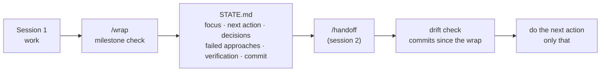

# wrap

[](https://github.com/msamy508/wrap/actions/workflows/validate.yml)
[](https://www.skills.sh/msamy508/wrap)
[](LICENSE)

**End the session at a milestone. Start the next one where it stopped.**

Long agent sessions drift: context gets compacted, decisions get lost, and the next session spends
its first hour re-deriving what the last one knew. `/wrap` closes the session on purpose. It writes
the current state to `STATE.md`, lists uncommitted work, keeps secrets out of that file, and names
the one next action. `/handoff` reads it in the next session, reports what changed since, and does
that action.

```bash
npx skills add msamy508/wrap
```

Then, at the end of a session:

```text
/wrap
/wrap focus on the migration decision
```

And in the next one:

```text
/handoff
```



## The two skills

| Skill | Job |
| --- | --- |
| [`wrap`](skills/wrap/SKILL.md) | Check the session is at a milestone, update one `STATE.md`, list uncommitted files, run an installed secrets scanner on it, and close with the single next action. Never pushes. |
| [`handoff`](skills/handoff/SKILL.md) | Find `STATE.md`, read it before the code, compare its recorded commit with the checkout, report the focus, blockers and drift, then do the next action and only that. Never edits `STATE.md`. |

## Install

You need [Claude Code](https://code.claude.com/docs/en/quickstart). Pick **one** way per machine;
installing the same skill twice gives you two copies with the same name.

**Skills CLI** (Node.js). The [skills](https://github.com/vercel-labs/skills) CLI copies the skills
into Claude Code or any other agent it supports:

```bash
npx skills add msamy508/wrap --list
npx skills add msamy508/wrap
npx skills add msamy508/wrap --skill '*' --agent claude-code --global --yes
```

Pin a release by appending its tag, for example `npx skills add msamy508/wrap@v0.1.0`. The CLI
installs by git tag, not by `metadata.version` in `SKILL.md`.

Update or remove (use `-g` if you installed with `--global`):

```bash
npx skills update wrap handoff -g -y
npx skills remove wrap handoff -g
```

**Claude Code plugin.** Inside Claude Code (2.1.275 or later):

```text
/plugin install wrap --marketplace msamy508/wrap
```

On older versions, add the marketplace first, then install:

```text
/plugin marketplace add msamy508/wrap
/plugin install wrap@wrap
```

Plugin skills are namespaced: type `/wrap:wrap` and `/wrap:handoff`. To update, refresh the
marketplace and then the plugin, and restart Claude Code:

```bash
claude plugin marketplace update wrap
claude plugin update wrap@wrap
```

**Manual copy.** Copy the `skills/wrap` and `skills/handoff` folders to `~/.claude/skills/`
(Windows: `%USERPROFILE%\.claude\skills\`), or to `.claude/skills/` in one repository. Keep the folder
names; they must match `name` in `SKILL.md`. If you created the skills folder during a session, run
`/reload-skills`.

Prefer plain command files? Copy `commands/wrap.md` and `commands/handoff.md` to
`~/.claude/commands/` or `.claude/commands/`. They run only when you type them; Claude never starts
a wrap on its own. A skill wins over a command file of the same name, so install one or the other.

**claude.ai.** Upload makes the skills available in the Claude apps; it does not replace the Claude
Code install.

- Free, Pro, and Max: turn on **Code execution and file creation** under **Settings > Capabilities**,
  then open **Customize > Skills**, choose **+**, **Create skill**, **Upload a skill**.
- Team and Enterprise: an owner enables Code execution and Skills under
  **Organization settings > Plugins & skills** if they are off.

Zip each skill folder from `skills/`, so the archive holds `wrap/SKILL.md`, not `SKILL.md` at its
root:

```bash
cd skills && zip -r ../wrap.zip wrap/ && zip -r ../handoff.zip handoff/ && cd ..
```

On Windows, use the built-in `tar` (it writes the forward-slash paths the uploader expects; call
`C:\Windows\System32\tar.exe` if another `tar` comes first on PATH):

```powershell
tar.exe -a -c -f wrap.zip -C skills wrap
tar.exe -a -c -f handoff.zip -C skills handoff
```

On claude.ai there is no git checkout unless that chat has the project files and code execution, so
the commit line reads "no git" and the secrets step reports that no scanner was found.

## What `/wrap` does

1. **Milestone check.** States what was completed, decided, and mid-flight. If stopping would
   break something, it asks and waits.
2. **One `STATE.md`.** The package you worked in, else the current directory. An existing file keeps
   its headings. A new one uses [the template](skills/wrap/assets/STATE.template.md)
   ([filled example](skills/wrap/assets/STATE.example.md)). It records:
   - the commit and branch it was written at;
   - each completed item tagged `[verified]` (a command in this session checked it) or `[unverified]`;
   - **Failed approaches**, so the next session does not retry them;
   - **Verification**: the check commands this session ran, with date and last result.

   It stays under about 150 lines; older entries move to `STATE.archive.md`.
3. **Loose ends.** Lists uncommitted paths from `git status --porcelain`. Commits only if you ask in
   that same turn, only the files you confirm, without git hooks. Never amends or pushes.
4. **Secrets.** Never writes tokens, passwords, keys or personal data into `STATE.md`. Runs
   `gitleaks`, `trufflehog` or `detect-secrets` on it only if one is already installed.
5. **Close.** One short block in your language: milestone, path, what is uncommitted, the next
   action, and what to type next time.

A good close:

> Wrap done. Milestone: Parquet writer matches the CSV output (212 tests pass).
> STATE.md updated (`./STATE.md`). Uncommitted: `export/parquet_writer.py`, `tests/test_parquet_writer.py`. No secrets scanner found.
> Next action: run `make nightly-dry` and compare row counts.
> This session can be closed. Next time: `/handoff`.

## What `/handoff` does

Finds `STATE.md` and reads it before exploring the code. If it records a commit, it lists the
commits and uncommitted changes since then, and treats whatever they touch as unverified. It tells
you the focus, the next action, any blocking decision, and what changed; then does that one action.
It does not retry anything under Failed approaches unless you ask.

It is not Claude Code's built-in `/resume`, which reopens an earlier conversation. `/resume` brings
back a chat; `/handoff` brings back the work.

## Requirements

- Claude Code (or another agent the Skills CLI supports) in a project directory.
- `git` for the uncommitted list and the drift check; without it, both say "no git".
- Optional: `gitleaks`, `trufflehog` or `detect-secrets` on PATH for the secrets check.

## Trust and validation

- Markdown only. No scripts, no dependencies, no network calls, no telemetry.
- The skills run `git status`, `git rev-parse`, `git branch` and `git log`, and only a secrets
  scanner you already installed. They never run scripts or binaries from your repository, never
  run git hooks, and never push.
- `/wrap` never edits your settings, `CLAUDE.md`, or any file other than `STATE.md` and
  `STATE.archive.md`.
- Every push runs [validate](.github/workflows/validate.yml): the Skills CLI must list both skills,
  the plugin and marketplace manifests must pass `claude plugin validate --strict`, and every version
  number must agree.

## Before you rely on it

- `STATE.md` is read by the next session and often by teammates. Commit it for a shared handover, or
  add it to `.gitignore` if it is personal.
- Other skills are also named `handoff`. If two are installed, the plugin namespace
  (`/wrap:handoff`) tells them apart.

## Optional hook

Remind each new or resumed session to read `STATE.md`. Claude Code adds what a `SessionStart` hook
prints to Claude's context. Merge this into the `hooks` object in `~/.claude/settings.json` or
`.claude/settings.json`; do not replace the whole file.

```json
{
  "hooks": {
    "SessionStart": [
      {
        "matcher": "startup|resume|compact",
        "hooks": [{ "type": "command", "command": "echo 'If STATE.md exists in this directory, read it before exploring the code.'" }]
      }
    ]
  }
}
```

## Repository shape

```text
.claude-plugin/
├── plugin.json          Claude Code plugin manifest (skills only)
└── marketplace.json     lets /plugin install from this repo
skills/
├── wrap/
│   ├── SKILL.md
│   └── assets/
│       ├── STATE.template.md
│       └── STATE.example.md
└── handoff/
    └── SKILL.md
commands/
├── wrap.md              same steps as a plain command file
└── handoff.md
skills.sh.json           grouping for skills.sh
```

Contributing? Read [CONTRIBUTING.md](CONTRIBUTING.md) and [AGENTS.md](AGENTS.md) first.

## License

[MIT](LICENSE)
